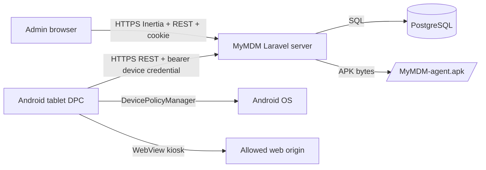

# Architecture

MyMDM is intentionally small: one Laravel server, PostgreSQL, one Inertia React console, and one native Android Device Policy Controller.

## Components

- `server/`: Laravel REST API, Inertia React admin console, auth, migrations, enrollment QR generation, device API, audit log.
- `legacy/`: previous Go/Vue implementation kept for reference during the refactor.
- `android/`: Kotlin DPC package `fr.organisation.MyMDM`.
- `docs/`: operational and development notes.

## Data Flow

1. Admin creates a one-shot enrollment token.
2. Server stores only a SHA-256 hash of that token.
3. Server builds Android Enterprise QR JSON using `MyMDM_BASE_URL`, APK URL, runtime APK checksum, package name, receiver component, and admin extras.
4. Android Setup Wizard installs the APK and provisions it as Device Owner.
5. The DPC enrolls with the temporary token and receives a per-device credential.
6. The DPC polls server policy roughly every 45 seconds and keeps the last valid policy locally for offline operation.
7. Admin uploads a newer APK release from `APK agent`; Laravel stores it privately, records version metadata, and marks it active.
8. The DPC checks `/api/v1/device/agent/update`; if the active release `version_code` is newer, it downloads `/downloads/MyMDM-agent.apk`, verifies SHA-256, and commits an Android package install session.

## Security Boundaries

- Admin identity uses Argon2id password hashes and HttpOnly session cookies.
- Device identity uses independent bearer credentials hashed server-side.
- Enrollment tokens are random, expiring, one-shot values and are never permanent device credentials.
- WebView navigation validates origins by scheme, host, and port.
- TLS validation is never disabled by the Android agent.
- The MVP transmits a non-cleartext admin PIN verifier to the device so local maintenance works offline. Before `0.1.0`, replace this verifier with an Android-compatible memory-hard verifier or a server-mediated rotation flow.
